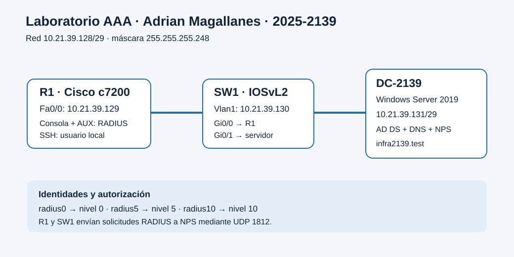
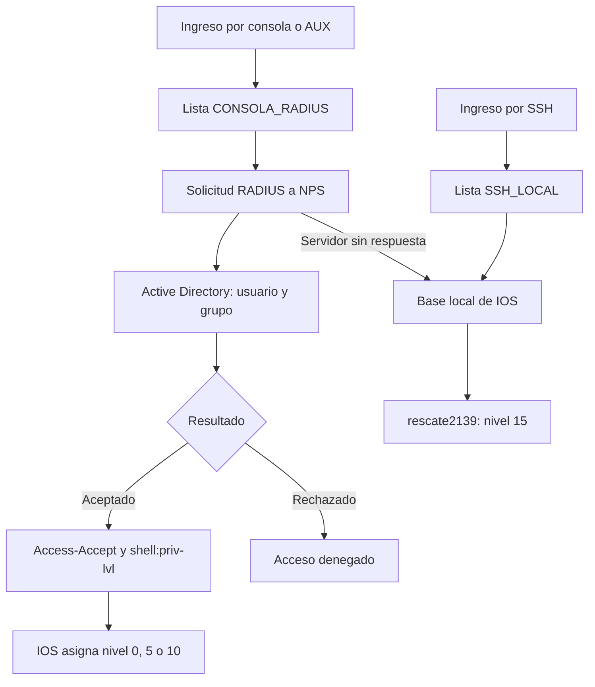

# Laboratorio de autenticación y autorización con RADIUS

Autor: Adrian Magallanes. Matrícula: 2025-2139.

Práctica: **A2**. Repositorio: [Laboratorio-AAA-RADIUS](https://github.com/adrianmgallaness-hash/Laboratorio-AAA-RADIUS). Implementación y pruebas documentadas; video pendiente de grabación.

## Propósito

Controlar el acceso administrativo a un router y un switch mediante cuentas de Active Directory y políticas NPS. Demostrar la asignación de privilegios, las restricciones de comandos, el acceso por consola y auxiliar, SSH con autenticación local y recuperación local ante indisponibilidad de RADIUS.

## Topología y direccionamiento

| Equipo | Plataforma | Interfaz | Dirección |
|---|---|---|---|
| R1 | Cisco c7200, IOS 15.2(4)S6, Dynamips | FastEthernet0/0 | 10.21.39.129/29 |
| SW1 | IOSvL2, compilación 20200929, QEMU | Vlan1 | 10.21.39.130/29 |
| DC-2139 | Windows Server 2019 Standard Evaluation | Ethernet0 2 | 10.21.39.131/29 |

Red: 10.21.39.128/29. Máscara: 255.255.255.248. Broadcast: 10.21.39.135. Puerta de enlace del servidor: 10.21.39.129. DNS del servidor: 10.21.39.131. Dominio: infra2139.test.

El direccionamiento utiliza 21 y 39, derivados de los últimos cuatro dígitos de la matrícula. R1 Fa0/0 conecta a SW1 Gi0/0; el servidor conecta a SW1 Gi0/1.

## Diseño de acceso

- Consola y AUX de ambos equipos: listas CONSOLA_RADIUS para autenticación y autorización EXEC, primero RADIUS y después local ante falta de respuesta del servidor.
- SSH versión 2: listas SSH_LOCAL, con usuario local de recuperación de nivel 15.
- Un rechazo de RADIUS no activa el respaldo local. La recuperación local se verificó deteniendo temporalmente IAS en el servidor.
- La elevación mediante enable requiere una contraseña administrativa independiente de las cuentas RADIUS.
- Los niveles de IOS heredan permisos inferiores; las siguientes son las diferencias de comandos configuradas para la demostración, no una lista exhaustiva de comandos disponibles.

| Comando | Nivel 0 | Nivel 5 | Nivel 10 |
|---|---|---|---|
| show privilege | Permitido | Permitido | Permitido |
| ping | Denegado | Permitido | Permitido |
| traceroute | Denegado | Denegado | Permitido |
| configure terminal | Denegado | Denegado | Denegado |

La asociación de políticas NPS utiliza grupos globales de seguridad GG_RADIUS_Nivel0, GG_RADIUS_Nivel5 y GG_RADIUS_Nivel10. Cada política concede acceso, admite PAP y devuelve Service-Type Login junto con Cisco-AVPair shell:priv-lvl correspondiente. Las políticas habilitadas se procesan en orden 10, 5, 0.

## Resultados verificados

| Prueba | Resultado observado |
|---|---|
| Conectividad hacia DC-2139 | R1 y SW1 obtuvieron 5/5 respuestas de ping |
| Consola R1 y SW1 | Usuarios radius0, radius5 y radius10 recibieron sus niveles correspondientes |
| Restricciones | Comandos de configuración rechazados en niveles 0/5/10; ping permitido en 5 y traceroute disponible en 10 |
| SSH entre R1 y SW1 | Usuario local de recuperación obtuvo nivel 15; show users identificó el origen remoto |
| AUX R1 | Usuario radius5 recibió nivel 5 y show users marcó aux 0 |
| AUX SW1 | Usuario radius5 recibió nivel 5 y show users marcó aux 0 |
| Respaldo local | Con IAS detenido, ambos equipos aceptaron rescate2139 y asignaron nivel 15 |
| Recuperación de NPS | IAS volvió a Running y ambos equipos autenticaron radius5 mediante RADIUS |
| Contraseña incorrecta desde SW1 | RADIUS rechazó el intento y NPS registró evento 6273, motivo 16 |
| Contraseña correcta desde SW1 | NPS registró evento 6272 y política AAA_Cisco_Nivel5 |
| Registros de R1 y SW1 | Access-Accept, shell:priv-lvl=5, Login Success y Authorization successful |
| Administración web de SW1 | HTTP y HTTPS desactivados; configuración guardada con [OK] |

Las pruebas proceden de salidas y capturas originales aportadas por el autor. La [galería de evidencias](../evidencias/README.md) permite revisar los resultados y su alcance. Los intentos de traceroute muestran disponibilidad del comando; no se afirma que sus sondas hayan completado una ruta exitosa.

## Evidencias conservadas

- [Galería de capturas originales y matriz de requisitos](../evidencias/README.md).

- [R1: autenticación, RADIUS y autorización](../evidencias/R1/aaa-sesion-radius5.txt).
- [R1: AUX](../evidencias/R1/aux-radius5.txt).
- [SW1: autenticación, RADIUS y autorización](../evidencias/SW1/aaa-sesion-radius5.txt).
- [SW1: AUX](../evidencias/SW1/aux-puerto5010.txt).
- [SW1: administración web desactivada](../evidencias/SW1/http-deshabilitado.txt).
- [Configuraciones sanitizadas](../configs/README.md).
- [NPS: exportación sanitizada](../configs/NPS-sanitized.xml).

## Incidencias resueltas

1. RADIUS no respondía pese al ping exitoso: se agregó en Windows una regla de entrada UDP 1812/1813 limitada a 10.21.39.129 y 10.21.39.130.
2. SW1 rechazó radius-server host: se utilizó radius server NPS con address ipv4 y key.
3. SSH no negociaba cifrado entre imágenes: se habilitó compatibilidad AES-CBC en SW1 y se especificó aes128-cbc al iniciar la conexión. Es una limitación de compatibilidad del entorno antiguo.
4. R1 no tenía puerto AUX asignado: se corrigió la asignación de Dynamips; el acceso quedó verificado en la GNS3 VM mediante TCP 5004.
5. SW1 solo tenía una conexión serie de QEMU: se agregó una segunda mediante -serial telnet:192.168.85.182:5010,server,nowait. La asignación a AUX se comprobó con show users.
6. Consola/AUX de R1 tenían nivel inicial 15: se restableció el nivel inicial 1 y se comprobó de nuevo el nivel 5 entregado por RADIUS.

Los puertos TCP de acceso serie del emulador y la IP de la GNS3 VM pertenecen al entorno de ejecución; no sustituyen las direcciones de administración ni las líneas VTY de IOS.

## Protección de archivos

Las configuraciones públicas sustituyen secretos y hashes por marcadores. El XML sanitizado no es un respaldo restaurable directamente. Los originales y los respaldos privados quedan fuera de Git mediante .gitignore. No se distribuyen las imágenes de IOS ni los discos de las máquinas virtuales.

## Pendientes para la entrega

- Grabar y publicar el video personal; añadir su enlace al principio del README y al TXT A2.
- Comprobar fecha, hora y zona horaria antes de grabar; las marcas de tiempo capturadas no demuestran sincronización NTP.
- El repositorio corresponde a una infraestructura compuesta por R1, SW1 y DC-2139. Si el docente exige separar cada equipo en una entrega independiente, se deberá adaptar la distribución de repositorios y videos.

## Alcance y límites

Se aplicó RADIUS exclusivamente a las listas de consola/AUX y autenticación local a SSH. Las listas configuradas y las sesiones reales están documentadas; esta interpretación resuelve la coexistencia de los dos requisitos del enunciado.

AAA se usa para autenticación y autorización EXEC por nivel. Los comandos se restringen localmente en IOS mediante `privilege exec`; no hay una decisión de NPS por cada comando. Los logs temporales de depuración capturan AAA/RADIUS y se deshabilitan al finalizar. Los eventos permanentes de inicio de sesión se habilitan con `login on-success log` y `login on-failure log`. No se afirma que exista contabilidad de comandos o almacenamiento persistente del buffer de IOS tras reiniciar.

El usuario local de recuperación tiene nivel 15. Una cuenta RADIUS de nivel inferior puede elevarse si conoce el secreto de `enable`; la protección de ese secreto es parte del diseño. Las claves usadas durante la práctica se omiten de todos los archivos publicados.

Las imágenes de IOS empleadas requieren compatibilidad AES-CBC para SSH entre sí. El laboratorio documenta esa limitación y no presenta esta combinación de software antiguo como una configuración moderna de producción.

## Referencias

- [Microsoft: instalar NPS](https://learn.microsoft.com/en-us/windows-server/networking/technologies/nps/nps-manage-install).
- [Microsoft: registrar NPS en AD](https://learn.microsoft.com/en-us/windows-server/networking/technologies/nps/nps-manage-register).
- [Microsoft: firewall para RADIUS](https://learn.microsoft.com/en-us/windows-server/networking/technologies/nps/nps-firewalls-configure).
- [Cisco: privilegios mediante RADIUS](https://www.cisco.com/c/en/us/support/docs/security-vpn/remote-authentication-dial-user-service-radius/13860-PRIV.html).
- [QEMU: puertos serie virtuales](https://www.qemu.org/docs/master/system/qemu-manpage.html).
