# Evidencias del laboratorio

Capturas originales suministradas por Adrian Magallanes durante las pruebas. Las imágenes enviadas como ventanas de aplicaciones se recuperaron de sus adjuntos originales; no se reconstruyeron pantallas ni resultados. Los archivos de texto conservan transcripciones complementarias.

## Matriz de requisitos

| Requisito | Evidencia |
|---|---|
| Router, switch y servidor conectados | [Topología](imagenes/01-topologia.png), [R1](imagenes/02-R1-Conectividad.png), [SW1](imagenes/03-SW1-Conectividad.png) |
| Direccionamiento según matrícula | [Servidor](imagenes/04-Servidor-red-NPS.png), [diagrama](../docs/diagramas/topologia.svg) |
| Grupos AD 0/5/10 | [Grupos y miembros](imagenes/05-Grupos-AD.png) |
| Clientes RADIUS en NPS | [Listado](imagenes/06-Clientes-RADIUS-recorte-parcial.png), [exportación NPS](../configs/NPS-sanitized.xml) |
| Políticas de privilegios | [Niveles 10/5](imagenes/07-NPS-Niveles10-5-completas.jpg), [nivel 0](imagenes/09-NPS-Nivel0.jpg) |
| Restricciones R1 | [Nivel 0](imagenes/10-R1-Nivel0.png), [5](imagenes/11-R1-Nivel5.png), [10](imagenes/12-R1-Nivel10.png) |
| Restricciones SW1 | [Nivel 0](imagenes/13-SW1-Nivel0.jpg), [5](imagenes/14-SW1-Nivel5.png), [10](imagenes/15-SW1-Nivel10.jpg) |
| Autenticación y autorización AUX | [R1](imagenes/16-R1-AUX.jpg), [SW1](imagenes/17-SW1-AUX.jpg) |
| SSH con cuenta local | [R1](imagenes/18-R1-SSH.jpg), [SW1](imagenes/19-SW1-SSH.jpg) |
| Listas AAA aplicadas a líneas | [R1](imagenes/20-R1-Lineas-AAA.jpg), [SW1](imagenes/21-SW1-Lineas-AAA.jpg), [running-configs](../configs/README.md) |
| SSH versión 2 | [R1](imagenes/22-R1-SSHv2.jpg), [SW1](imagenes/23-SW1-SSHv2.jpg) |
| Logs de acceso, AAA y RADIUS | [R1 acceso](imagenes/24a-R1-Logs-acceso.jpg), [R1 AAA](imagenes/24b-R1-Logs-AAA-RADIUS.jpg), [SW1 acceso](imagenes/25a-SW1-Logs-acceso.jpg), [SW1 AAA](imagenes/25b-SW1-Logs-AAA-RADIUS.jpg) |
| NPS acepta y rechaza | [6272 SW1](imagenes/26a-NPS-Aceptado-SW1.png), [6272 R1](imagenes/26b-NPS-Aceptado-R1.png), [6273](imagenes/27-NPS-Rechazado-usuario-inexistente.png) |
| Respaldo local y restauración | [IAS detenido](imagenes/28-NPS-Detenido.png), [R1 local](imagenes/29-R1-Respaldo-local.png), [SW1 local](imagenes/30-SW1-Respaldo-local.jpg), [IAS Running](imagenes/31-NPS-Restaurado.jpg) |

## Topología y conectividad

## Active Directory y NPS

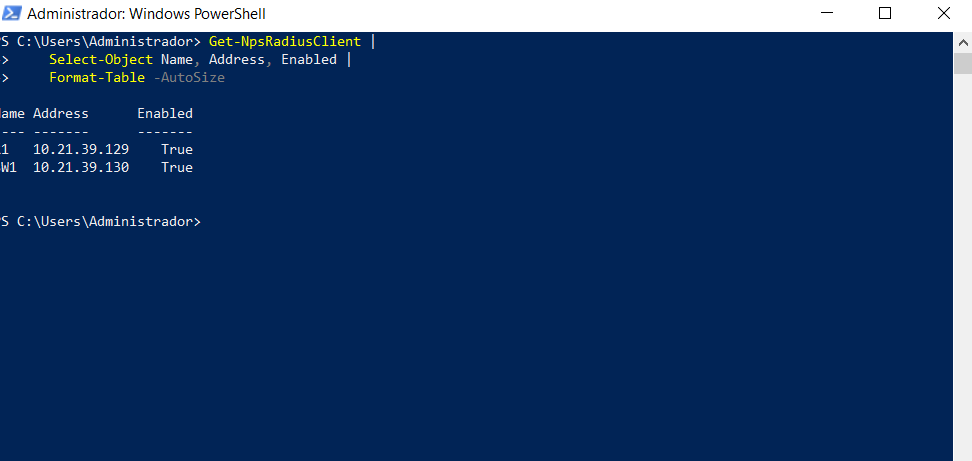

El borde izquierdo del listado de clientes quedó recortado en el original. Las IP y `Enabled=True` son legibles; los nombres completos R1 y SW1 se corroboran con la exportación NPS y los eventos de autenticación.

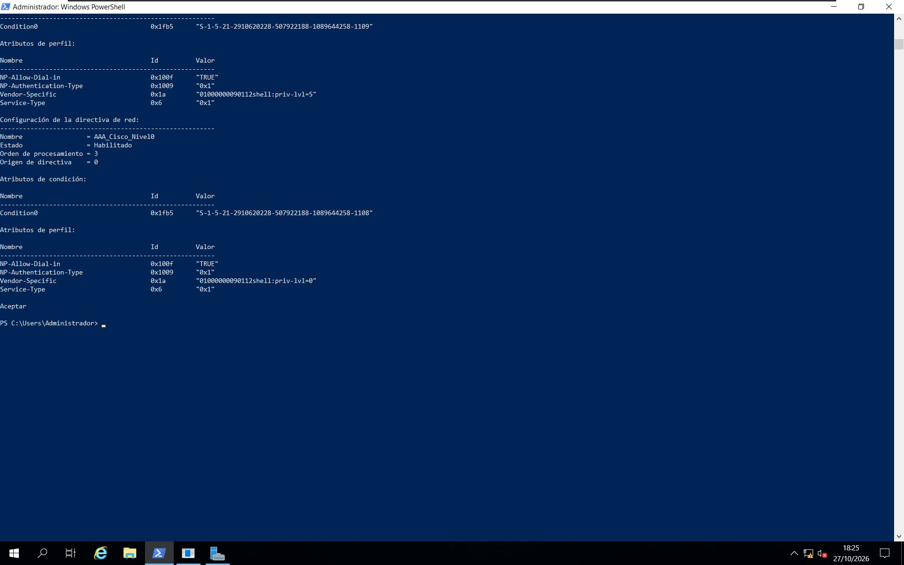

## Privilegios de R1

Los asteriscos del traceroute indican ausencia de respuesta a sus sondas. La evidencia demuestra que el usuario puede invocar el comando; la conectividad ICMP se prueba con los pings independientes.

## Privilegios de SW1

En la última captura hay intentos previos de autenticación fallidos. El acceso posterior sí asigna nivel 10. El error final de traceroute corresponde a un destino vacío; la ayuda muestra que el comando está disponible.

## AUX

El asterisco en `show users` identifica la sesión actual. En ambas pruebas aparece en `aux 0` y el nivel recibido es 5.

## SSH y líneas de acceso

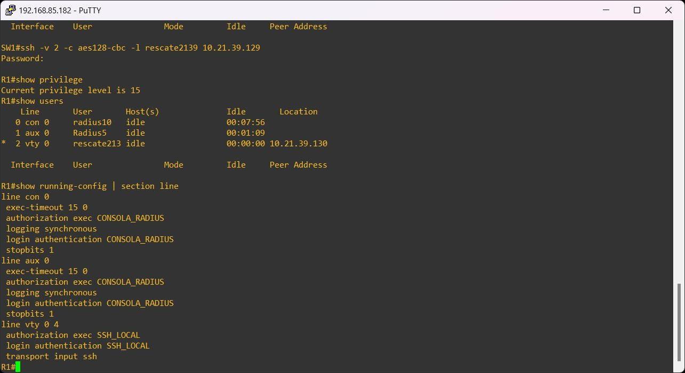

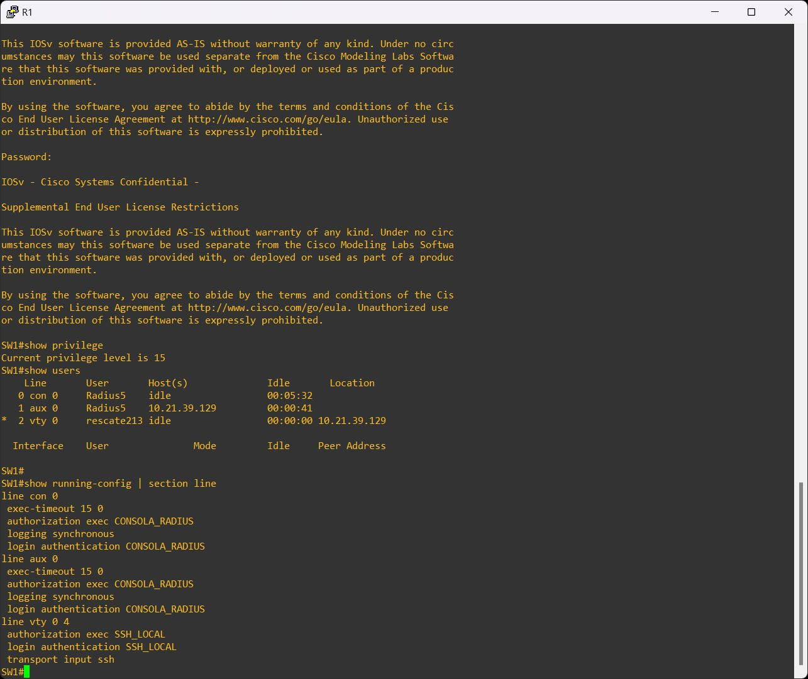

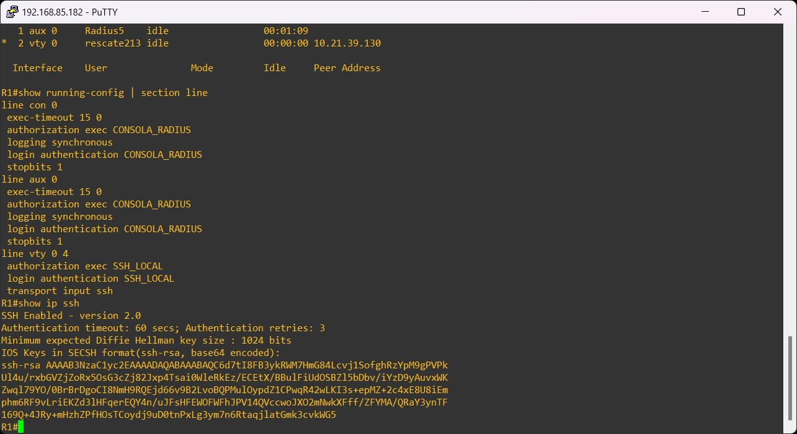

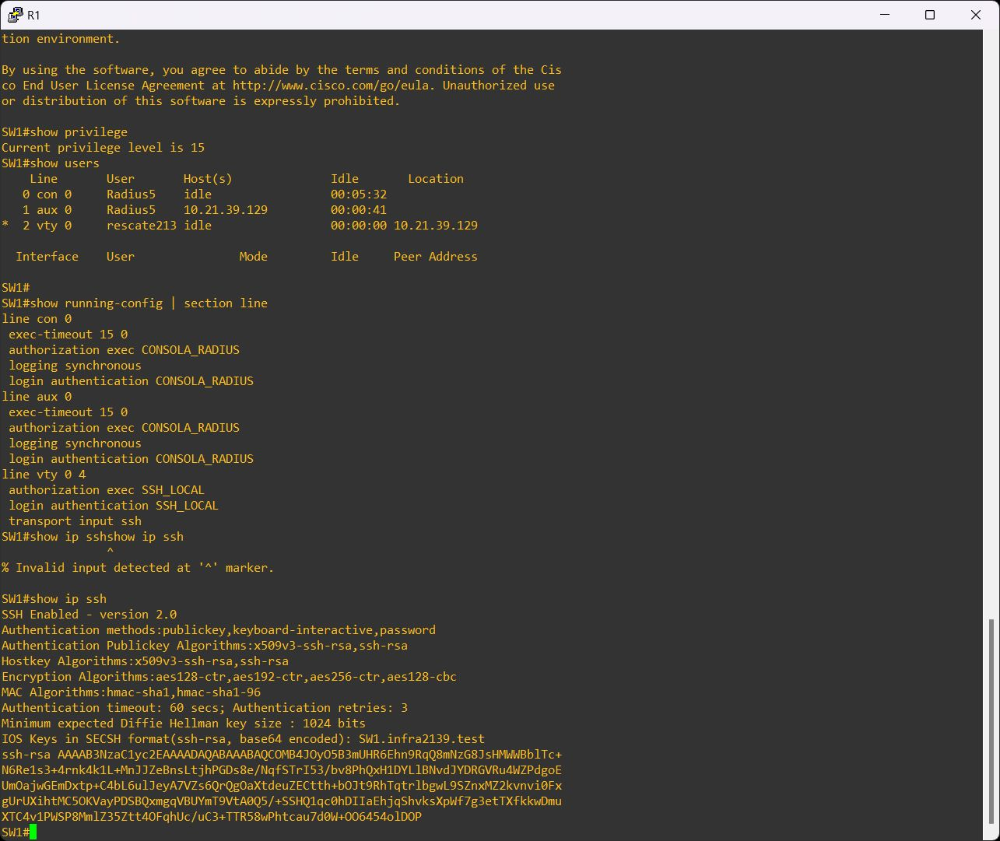

El título de una ventana puede seguir diciendo R1 mientras se está conectado por SSH a SW1. El prompt del equipo y la fila VTY de `show users` identifican el destino real. Las cadenas RSA visibles son claves públicas, no claves privadas.

## Registros de autenticación y autorización

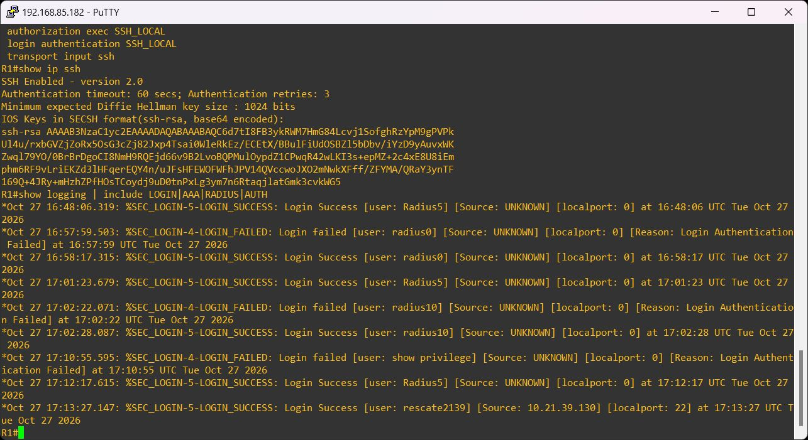

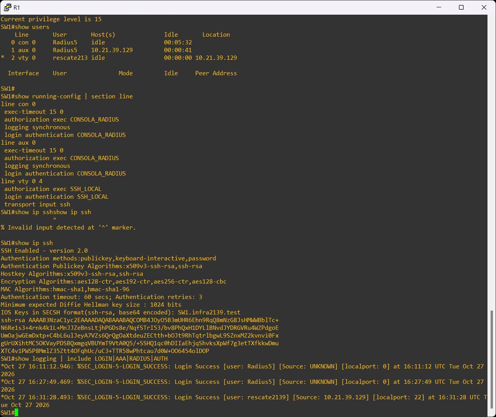

Las capturas de detalle muestran que la depuración se apagó mediante `undebug all`. Un intento de elevación con contraseña incorrecta también queda registrado en SW1. Esa elevación es independiente del acceso RADIUS exitoso de nivel 5.

## Auditoría NPS

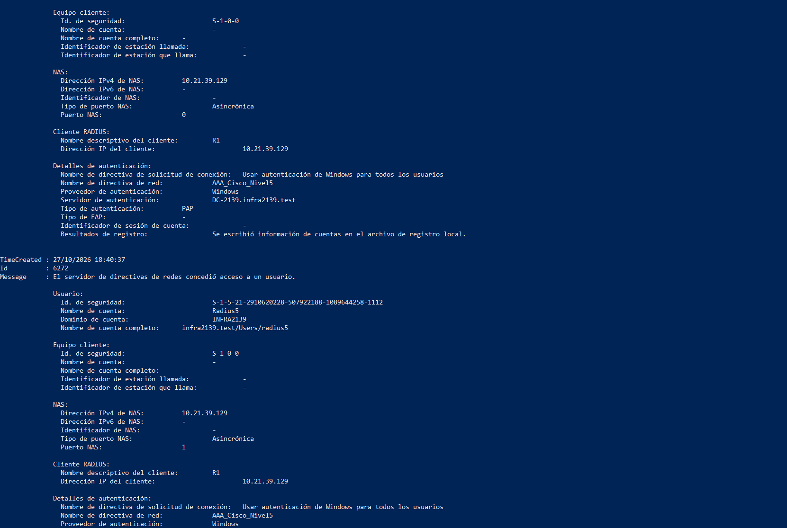

El evento 6273 conservado corresponde al texto `show privilege` introducido accidentalmente como nombre de usuario. NPS lo rechazó con motivo 16. Se documenta como rechazo de credenciales inválidas, no como una prueba de contraseña errónea de `radius5`.

## Recuperación local

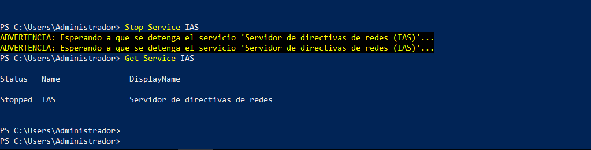

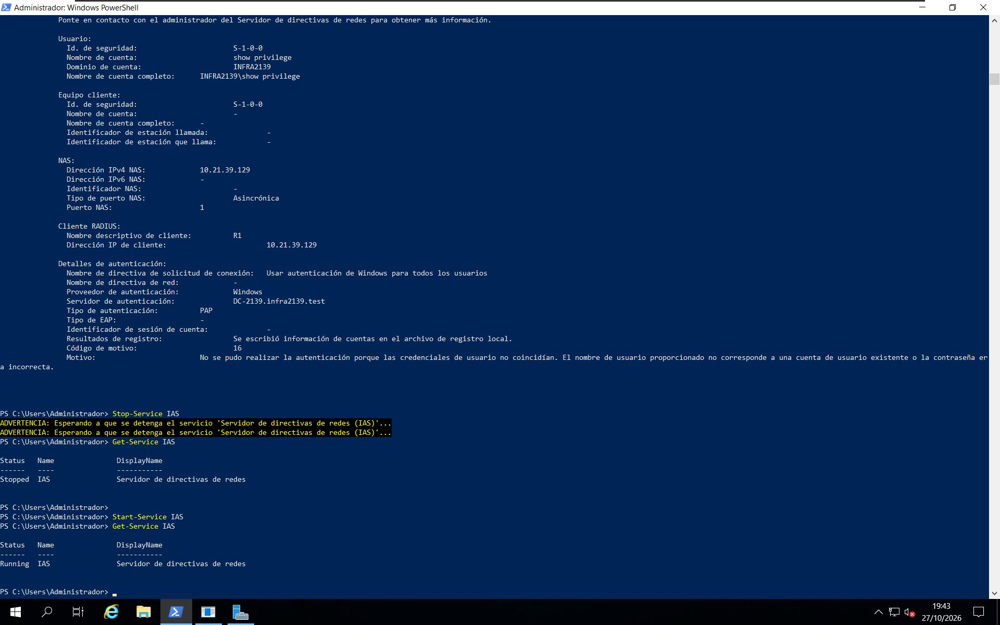

La secuencia muestra el respaldo local durante la indisponibilidad de NPS. La lista `group radius local` utiliza la base local si RADIUS no responde; un rechazo explícito del servidor no equivale a indisponibilidad.

## Transcripciones y procedencia

- [R1: sesión AAA](R1/aaa-sesion-radius5.txt)
- [R1: AUX](R1/aux-radius5.txt)
- [SW1: sesión AAA](SW1/aaa-sesion-radius5.txt)
- [SW1: AUX](SW1/aux-puerto5010.txt)
- [SW1: HTTP/HTTPS desactivados](SW1/http-deshabilitado.txt)
- [Inventario SHA-256 de las imágenes](inventario-imagenes.csv)

Los errores de entrada y los avisos originales visibles se conservan. Las marcas de tiempo de Windows y Cisco difieren; no se ha certificado sincronización entre relojes.
